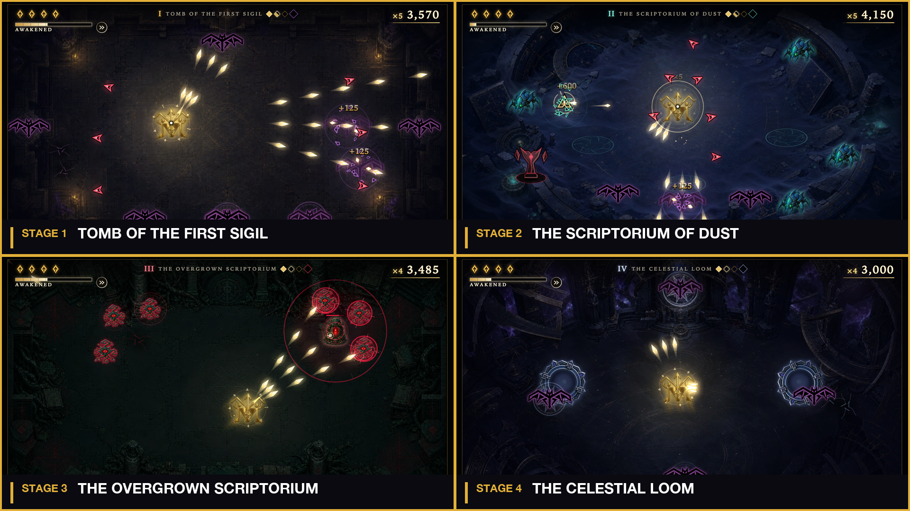

# Living Sigil

**A four-stage twin-stick action game about awakening an ancient symbol and reclaiming the lost sigils of the Cosmic Ascent.**

### [Play Living Sigil in your browser](https://vibezzzcoder.github.io/living-sigil/)

Built by **Edwin RodMen** ([@edwin_rodmen](https://www.instagram.com/edwin_rodmen/)). Website: <https://sigil.erodmen.com/>. Source: <https://github.com/VibezZzCoder/living-sigil>.

## About the game

You are the Living Sigil: a dormant mark awakened inside a forgotten tomb. Fight through four ancient arenas, survive their guardians, and reclaim the First, Dust, Verdant, and Astral Sigils.

Each stage introduces a new battlefield rule. Quicksand slows your escape, crimson wards protect enemies, and linked portals fold the arena around you. Defeat the Astral Weaver and unite all four sigils to complete the first Cosmic Ascent.

Living Sigil plays directly in a desktop or mobile browser. No installation is required.

## How to play

Move and shoot independently, clear each stage's waves, defeat its guardian in three acts, and touch the fallen sigil to reclaim it. Collecting a sigil restores your health before the next stage.

- **Sigil Step** is a short blink that passes through enemies and bullets. Stepping through danger at the last moment is a perfect step: it slows time for an instant and feeds the Awakening meter.
- **Awakening** fills as you defeat enemies. Activating it releases a Nova that dissolves nearby bullets, then you move faster and fire a three-shot spread for a few seconds; kills extend it. You can keep fighting with a full meter to overcharge it for a longer Awakening.
- Kills in quick succession build a **chain** that multiplies your score up to x8. Any wound breaks it.
- Clearing a wave without being hit restores one health. Crowned enemies drop a health mote.
- Each stage ends with a rank from S to C, and your best ranks and score are kept.
- If you fall at a guardian you can **Face the Guardian** again directly, or **Rise Again** from the start of the stage.
- Finish all four stages to unlock the **Second Ascent**, a faster and denser second journey.

| Action | Keyboard and mouse | Gamepad | Touch |
| --- | --- | --- | --- |
| Move | `W` `A` `S` `D` | Left stick | Drag on the left side |
| Aim and fire | Mouse (hold the left button), or arrow keys | Right stick | Drag on the right side |
| Sigil Step | `Shift` or right click | `A` or `RB` | Step button |
| Awaken | `Space` | `Y` | Awaken button |
| Pause / resume | `Esc` or `P` | `Start` | Pause button |
| Mute | `M` | | Settings |

On a phone in portrait the arena is shown through a closer view that follows you; markers at the edge point to threats outside it. Settings has a "Portrait view" switch for the full arena, plus volume, screen shake, flashes, vibration and aim assist.

## The four stages

### Stage 1 — Tomb of the First Sigil

Learn the core rhythm against swarms of Shadow Wings: keep moving, fire in a different direction, and build Awakening energy. The **Gold Wing Warden** waits at the end of the tomb and guards the First Sigil.

### Stage 2 — The Scriptorium of Dust

Glowing quicksand circles cut your movement speed in half, while **Sand Dashers** telegraph sudden charges across the buried archive. Stay out of the slow zones when a dash is coming, then defeat the **Guardian of the Scriptorium** to reclaim the Dust Sigil.

### Stage 3 — The Overgrown Scriptorium

Crimson **Warded Glyph Anchors** protect nearby enemies. You can still damage a protected enemy, but destroying its anchor first is far more effective. Break the wards, clear the Vine Glyphs, and overcome the **Bramble Heart** to purify the Verdant Sigil.

### Stage 4 — The Celestial Loom

Two linked Astrolabe Portals teleport both you and the stage's Star Cores across the arena. Learn where each portal exits, watch for the Star Cores' cardinal shard bursts, and use the portals to escape the **Astral Weaver's** sweeping attacks. Reclaiming the Astral Sigil completes the four-stage arc.

## Quick tips

- Keep moving. Contact with an enemy costs health even if no projectile hits you.
- Only the small bright dot at your centre can be hit by bullets. A wound throws nearby enemies back, so use the moment to get clear.
- A Shadow Wing that flares crimson is about to lunge along the marked lane. Step through it or sidestep.
- Watch for telegraphs before Sand Dasher charges and boss attacks.
- In Stage 3, red ward circles are a target-priority clue: destroy the anchor before focusing on the enemies inside.
- Save Awakening for crowded waves or a boss opening when you can use the full burst.
- After defeating a guardian, move onto the dropped sigil to continue.

## License

The software source code is licensed under the [MIT License](CODE_LICENSE.md).

The original artwork, symbols, sprites, character and enemy designs, visual identity, reference images, generated art, processed art, and embedded image assets are copyright © 2005–2026 Edwin RodMen and are covered by the [Living Sigil Asset License](ASSET_LICENSE.md). They may be viewed, shared, and used with this game for non-commercial purposes; commercial use requires prior written permission.
